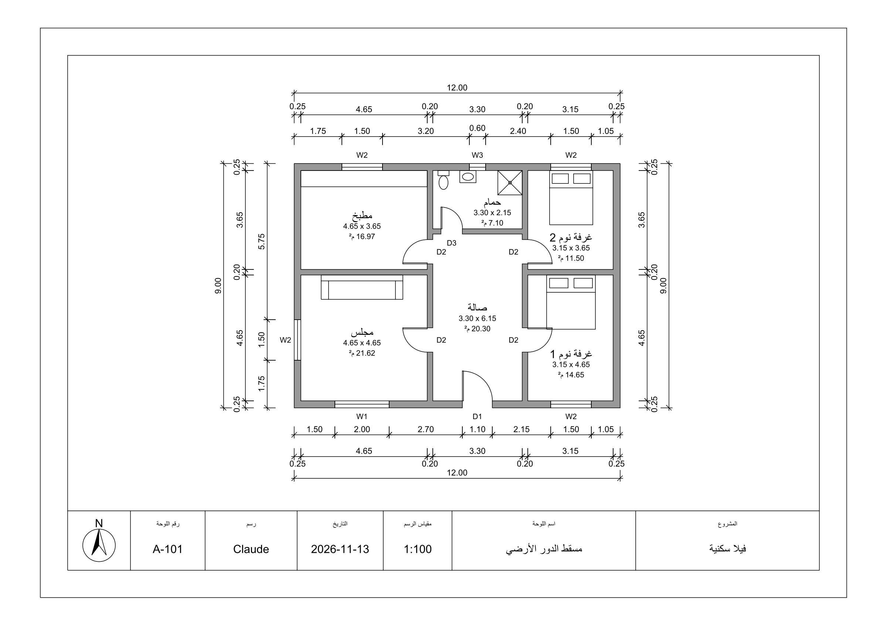
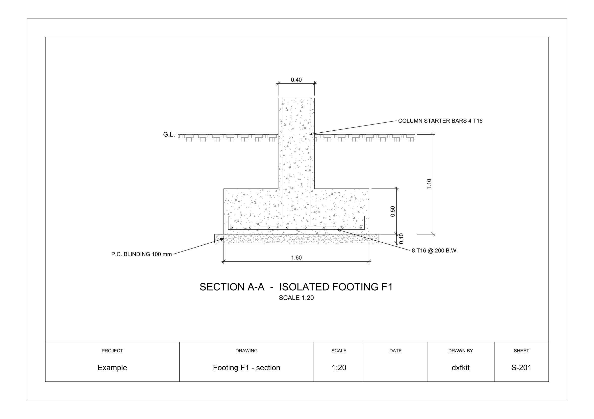

# dxf-drafting

A [Claude Code](https://claude.com/claude-code) skill that draws 2D architectural and engineering
drawings as real CAD files: DXF that opens in AutoCAD, BricsCAD, LibreCAD and ZWCAD.

مهارة لـ Claude Code ترسم المخططات المعمارية والهندسية ثنائية الأبعاد كملفات DXF حقيقية تُفتح في أوتوكاد.



<div dir="rtl">

## بالعربية

### ماذا تفعل

- **المساقط الأفقية** من وصف مكتوب: جدران، أبواب، نوافذ، أسماء الغرف ومساحاتها، سلاسل أبعاد تلقائية، محاور وأعمدة، درج، أثاث، إطار لوحة، ولوحة طباعة جاهزة بالمقياس.
- **رسومات أخرى** عبر مكتبة مساعدة: قطاعات، تفاصيل قواعد وبلاطات، مخططات أساسات، مخطط موقع، مع تهشير المواد.
- **ملفات DXF موجودة**: قراءتها وتعديلها وحفظها باسم جديد.
- **معاينة** أي ملف DXF كصورة PNG أو ملف PDF.
- العربية مدعومة في أسماء الغرف وإطار اللوحة.

### التثبيت

انسخ المستودع إلى مجلد المهارات:

</div>

```bash
git clone https://github.com/rmabood9-web/dxf-drafting ~/.claude/skills/dxf-drafting
```

<div dir="rtl">

وعلى ويندوز (PowerShell):

</div>

```powershell
git clone https://github.com/rmabood9-web/dxf-drafting "$env:USERPROFILE\.claude\skills\dxf-drafting"
```

<div dir="rtl">

ثم ثبّت المكتبات المطلوبة:

</div>

```bash
python -m pip install ezdxf shapely matplotlib arabic-reshaper python-bidi
```

<div dir="rtl">

### الاستخدام

اطلب من Claude ما تريد رسمه، مثلاً:

- «ارسم لي مسقط شقة 10×12 متر فيها مجلس وغرفتين ومطبخ وحمامين»
- «ارسم قطاع قاعدة منفصلة 1.6×1.6 م بعمق 50 سم بمقياس 1:20»
- «افتح هذا الملف plan.dxf وأعطني قائمة الطبقات ومساحات الغرف»

### حدودها

- رسم ثنائي الأبعاد فقط.
- لا تقرأ ملفات DWG؛ احفظها من أوتوكاد بصيغة DXF أولاً.
- ترسم ما يُحدَّد لها ولا تصمّم إنشائياً ولا تراجع الأكواد. مقاسات العناصر والتسليح تأتي من المهندس.

</div>

## English

### What it does

- **Floor plans** from a written description: walls, doors, windows, room names and areas,
  automatic dimension chains, structural grids and columns, stairs, furniture, a title block and
  a paper layout set up to plot at scale.
- **Other drawings** through a small helper library (`dxfkit`): sections, footing and slab
  details, foundation layouts, site plans, with material hatches.
- **Existing DXF files**: inspect them, edit them, save under a new name.
- **Previews** of any DXF as PNG or PDF.
- Arabic text works in room labels and the title block.

### Install

```bash
git clone https://github.com/rmabood9-web/dxf-drafting ~/.claude/skills/dxf-drafting
python -m pip install ezdxf shapely matplotlib arabic-reshaper python-bidi
```

On Windows (PowerShell) the target folder is `"$env:USERPROFILE\.claude\skills\dxf-drafting"`.

### Use

Ask Claude for the drawing:

- "Draw a floor plan of a 10 x 12 m apartment with a living room, two bedrooms, a kitchen and two bathrooms"
- "Draw a section through an isolated footing 1.6 x 1.6 m, 0.5 m deep, at 1:20"
- "Open plan.dxf and list its layers and room areas"

The scripts also run on their own:

```bash
python scripts/plan_to_dxf.py assets/example-plan.json plan.dxf --preview plan.png
python assets/example_footing_section.py footing.dxf footing.png
python scripts/dxf_preview.py plan.dxf plan.pdf
python scripts/dxf_inspect.py plan.dxf
```

### What is in the repository

| Path | Contents |
|---|---|
| `SKILL.md` | The instructions Claude follows |
| `scripts/plan_to_dxf.py` | Floor plan generator: JSON spec in, DXF out |
| `scripts/dxfkit.py` | Helper library for any other drawing (layers, dimensions, hatches, title block, paper layout) |
| `scripts/dxf_preview.py` | Render a DXF to PNG or PDF |
| `scripts/dxf_inspect.py` | Summarise an existing DXF |
| `references/` | Full reference for the plan spec and the `dxfkit` API |
| `assets/` | A sample plan spec and a worked section example |
| `examples/` | Drawings produced by the skill |



### Limits

- 2D only.
- It cannot read DWG. Export to DXF first (AutoCAD: `SAVEAS` > DXF).
- It drafts what is specified. It does not size structure, check codes or replace an engineer's
  or architect's review; member sizes and reinforcement must come from the engineer.

### Tested with

Python 3.12, ezdxf 1.4.5, shapely 2.2.0, matplotlib 3.11.2. Output files are DXF R2013 and pass
`python -m ezdxf audit`. They have not yet been checked in AutoCAD itself, so please open an issue
if a file misbehaves in your CAD program.

### License

MIT. See [LICENSE](LICENSE).
